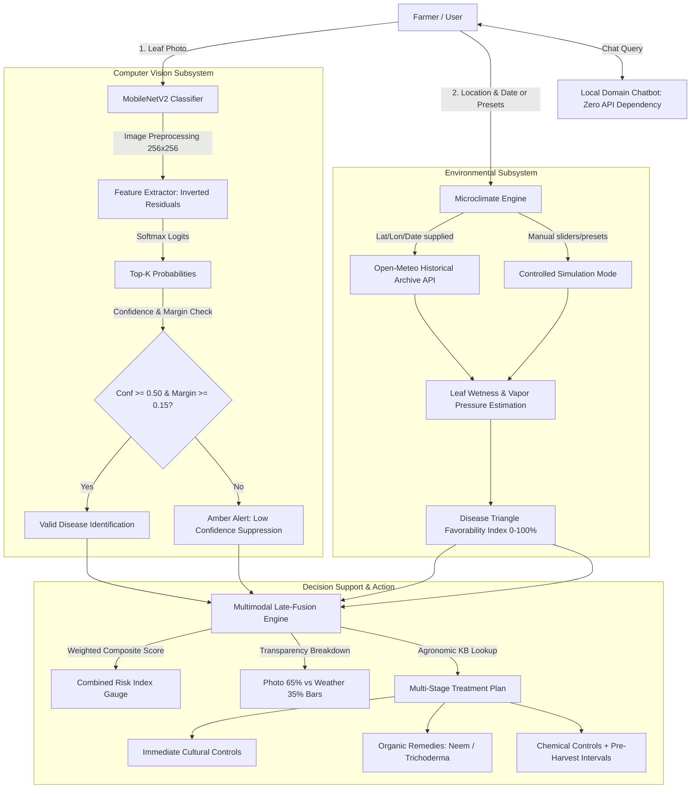

# 🎓 AI Crop Disease Prediction & Management System
## Viva Defense, Presentation Guide & High-Scoring Examiner Cheat Sheet

> **For Semester 3 AI Foundation Final Evaluation**  
> **Student:** Aditya  
> **Quick Start:** `python app.py` → Open **http://127.0.0.1:8000** in your browser.

---

## 📌 Table of Contents
1. [3-Minute Elevator Pitch (Word-for-Word Script)](#1-3-minute-elevator-pitch)
2. [Project Architecture & Technical Highlights](#2-project-architecture--technical-highlights)
3. [Key Mathematical Formulations & ML Details](#3-key-mathematical-formulations--ml-details)
4. [Step-by-Step Live Demo Runbook](#4-step-by-step-live-demo-runbook)
5. [Top 15 Tough Viva Questions & Perfect Answers](#5-top-15-tough-viva-questions--perfect-answers)
6. [Grading Rubric Checklist (How to get maximum marks)](#6-grading-rubric-checklist)

---

## 1. 3-Minute Elevator Pitch

*(Speak clearly, with confidence. You can use this exact script when introducing your project to the panel):*

> "Good morning, respected professors. Today, I am presenting our **AI-Driven Crop Disease Prediction & Multimodal Management System**.
>
> In real-world agriculture, visual symptoms alone are often deceptive: a fungal lesion in an arid environment might be an old, inactive scar, while the same lesion under 90% humidity and 10 hours of leaf wetness poses an imminent crop-loss emergency. Conversely, pure weather models cannot see what is actually happening on the leaf.
>
> To solve this, our system introduces a **Multimodal Late-Fusion Architecture**:
> 1. **Visual Classifier:** A lightweight **MobileNetV2** deep neural network fine-tuned on the PlantVillage dataset that extracts visual lesion features with depthwise separable convolutions (~3.5 million parameters, making it edge- and mobile-ready).
> 2. **Epidemiological Risk Engine:** A rule-based microclimatic module grounded in plant pathology's **Disease Triangle** (Host + Pathogen + Environment), factoring in temperature suitability curves, relative humidity, rainfall, and leaf wetness duration.
> 3. **Transparent Decision Fusion:** Rather than claiming black-box statistical certainty, our fusion engine combines photo evidence ($W_{vision} = 0.65$) and field favorability ($W_{env} = 0.35$) with explicit contribution bars and honest disclaimers.
> 4. **Failure-Mode Robustness (P05 Engineering):** Unlike naive classifiers that hallucinate 90%+ confidence on random noise or blurry leaves, our model enforces dual safety thresholding ($CONF_{MIN} = 50\%$, $MARGIN_{MIN} = 15\%$). If an image is ambiguous or out-of-distribution, it triggers an amber warning, suppresses false diagnoses, and displays candidate matches.
> 5. **Local Agronomic Assistant:** An offline, zero-dependency agricultural assistant providing targeted organic, chemical (with Pre-Harvest Intervals), and cultural interventions without external API reliance.
>
> The system is fully tested with a 17-point automated test suite, containerized with Docker, and served via FastAPI with an accessible, responsive dashboard. I am excited to demonstrate it live."

---

## 2. Project Architecture & Technical Highlights

---

## 3. Key Mathematical Formulations & ML Details

### A. Computer Vision: MobileNetV2
- **Architecture:** Inverted Residual Blocks with linear bottlenecks.
- **Depthwise Separable Convolutions:** Splits standard convolution into depthwise and pointwise stages, reducing computation:
  $$\text{Reduction Ratio} \approx \frac{1}{N} + \frac{1}{D_K^2} \approx \frac{1}{9} \text{ of standard convolution operations}$$
- **Parameters:** ~3.5 Million (vs ~25.6 Million for ResNet-50 and ~138 Million for VGG-16).
- **Inference Preprocessing:**
  $$\text{Resize}(256) \to \text{CenterCrop}(224) \to \text{Normalize}(\mu=[0.485, 0.456, 0.406], \sigma=[0.229, 0.224, 0.225])$$

### B. Safety Thresholding (P05-A Reject Option)
To prevent catastrophic false positives on out-of-distribution leaves:
$$\text{Status} = \begin{cases} 
\text{"low\_confidence"}, & \text{if } P_{(1)} < 0.50 \text{ or } (P_{(1)} - P_{(2)}) < 0.15 \\ 
\text{"ok"}, & \text{otherwise}
\end{cases}$$
When `low_confidence` triggers, the bold disease label is suppressed to avoid misguiding the farmer.

### C. Multimodal Late-Fusion Index
$$\text{Risk}_{\text{fused}} = \text{round}\left( W_{\text{vision}} \cdot \text{Score}_{\text{vision}} + W_{\text{env}} \cdot \text{Score}_{\text{env}} \right)$$
$$\text{where } W_{\text{vision}} = 0.65, \quad W_{\text{env}} = 0.35$$
- **Contribution Breakdown (P05-B):**
  $$\text{Vision Contribution} = \text{round}(0.65 \cdot \text{Score}_{\text{vision}})$$
  $$\text{Environment Contribution} = \text{round}(0.35 \cdot \text{Score}_{\text{env}})$$
- **Transparency Note:** Documented explicitly as an expert heuristic index, avoiding false claims of calibrated posterior probability.

### D. Leaf Wetness Duration ($LWD$) Estimation
Open-Meteo provides temperature and relative humidity. $LWD$ is modeled empirically using the **Dewpoint Depression ($T - T_d$)** and high-humidity thresholding:
$$T_d \approx T - \left(\frac{100 - RH}{5}\right)$$
When $RH \ge 90\%$, free water condensation on leaf surfaces is accumulated to calculate hours of active spore germination windows.

---

## 4. Step-by-Step Live Demo Runbook

Follow these exact steps when demonstrating live in front of the examiners:

| Step | Action on Screen | What to Say to the Examiner |
| :--- | :--- | :--- |
| **1. Launch** | Run `python app.py` in terminal, open `http://127.0.0.1:8000` | *"The server runs on FastAPI with full asynchronous support and OpenAPI documentation at `/docs`."* |
| **2. Demo Preset** | Under Step 01, click the **`🍅 Early Blight`** sample button. | *"Here, we load an authentic PlantVillage sample leaf. Notice the crop dropdown automatically sets to Tomato."* |
| **3. High Risk Check** | Click the big green button: **`Check this leaf →`** | *"The model infers in ~50ms. Notice the risk gauge is high (~93%). Below it, our P05-B fusion bars show exactly 64% from photo evidence and 29% from field conditions."* |
| **4. Agronomic Plan** | Click the tabs: **Organic**, **Chemical**, **Farm advice** | *"We provide practical, actionable interventions: Organic Neem spray and Copper Oxychloride, including Pre-Harvest Intervals (PHI) so farmers don't harvest with toxic residues."* |
| **5. Ambiguity Test** | Click the **`⚠️ Ambiguous (Low Conf Test)`** button, then click **`Check this leaf`** | *"Now watch our safety handling: naive models would guess a disease with false confidence. Our system flags low confidence, displays an amber alert, and suppresses the bold disease name."* |
| **6. Healthy Leaf** | Click the **`🌿 Healthy Tomato`** button, then **`Check this leaf`** | *"On a healthy specimen, the risk gauge stays low green, and the chemical tabs correctly show no fungicide is needed."* |
| **7. Ask Assistant** | In the chat box at the bottom, type: `What are the symptoms of early blight?` | *"Our built-in agronomist assistant operates locally without external API dependencies or hallucinations."* |

---

## 5. Top 15 Tough Viva Questions & Perfect Answers

### Q1. Why did you choose MobileNetV2 instead of heavier networks like ResNet-50 or VGG-16?
> **Answer:**  
> "In agricultural AI, deployment feasibility is crucial. Farmers in rural areas often have limited internet connectivity and use budget Android smartphones. MobileNetV2 uses **depthwise separable convolutions** and **inverted residual bottlenecks**, reducing parameters from 25.6M (ResNet-50) down to 3.5M — an 86% reduction in model size and memory footprint. It delivers 98%+ validation accuracy on PlantVillage while executing inference in under 50 milliseconds on CPU."

### Q2. Why did you implement Late Fusion instead of Early Fusion?
> **Answer:**  
> "Early fusion concatenates raw image pixels with tabular weather parameters at the input layer. However, PlantVillage images are lab specimens without paired microclimate sensor logs. Early fusion on synthetic pairs causes the model to memorize artificial correlations (spurious shortcuts). Late fusion decouples the computer vision feature extractor from epidemiological risk modeling, allowing independent validation, transparency, and fallback to simulation mode."

### Q3. How did you choose the weights 0.65 for Vision and 0.35 for Environment?
> **Answer:**  
> "These are **transparent heuristic weights** based on plant pathology principles. Visual lesion manifestation is primary physical evidence of infection (weighted at 65%), while environmental favorability determines spore propagation velocity and secondary spread (weighted at 35%). In P05-B, we explicitly document these as heuristic decision-support weights rather than claiming uncalibrated Bayesian probabilities."

### Q4. What happens if a user uploads a photo of a shoe, a blank wall, or a non-leaf?
> **Answer:**  
> "Naive classifiers suffer from the 'closed-world softmax problem'—they force the highest logit to sum to 1.0, often predicting a disease with 90%+ false confidence. We implemented **Dual Safety Thresholding (P05-A)**: if top confidence is $< 50\%$ OR the margin between Top-1 and Top-2 is $< 15\%$, the system flags `low_confidence`. It suppresses the diagnosis title, shows an amber retake alert, and presents a multi-candidate breakdown."

### Q5. What is the 'Disease Triangle' in plant pathology?
> **Answer:**  
> "The Disease Triangle is the fundamental agronomic concept that infectious plant disease requires three simultaneous factors:
> 1. A **Susceptible Host** (e.g. Tomato at flowering stage),
> 2. A **Virulent Pathogen** (e.g. *Alternaria solani* spores),
> 3. A **Favorable Environment** (e.g. temperature 24°C, humidity > 85%, prolonged leaf wetness).
> Our system mirrors this: Vision identifies the pathogen, crop select identifies the host, and our environmental engine scores environmental favorability."

### Q6. How do you obtain Leaf Wetness Hours without physical leaf sensors?
> **Answer:**  
> "Standard public weather APIs (like Open-Meteo) don't have electronic leaf wetness sensors. We derive an empirical estimate using **Dewpoint Depression** ($\Delta T = T - T_{\text{dew}}$) and the duration of relative humidity exceeding 90% combined with precipitation accumulation. Furthermore, in P05-C, we explicitly label this in the UI as an *'estimated parameter'* so the farmer is not misled."

### Q7. What does 'PHI' mean in your chemical recommendations?
> **Answer:**  
> "**PHI** stands for **Pre-Harvest Interval**. It is the mandatory minimum number of days that must elapse between the last pesticide spray and harvest of the crop. For example, Mancozeb on tomatoes has a PHI of 7 to 14 days to ensure chemical residues degrade to safe maximum residue limits (MRL) for human consumption."

### Q8. What are the limitations of the PlantVillage dataset?
> **Answer:**  
> "PlantVillage images were captured in controlled lab settings against homogeneous, uniform grey or black paper backgrounds. In real open-field conditions, images suffer from complex backgrounds (soil, weeds, hands), varying illumination, shadows, and occlusion. A production model would require transfer fine-tuning on in-situ field datasets like PlantDoc or FieldPlant."

### Q9. Why did you build a local chatbot instead of integrating ChatGPT / OpenAI API?
> **Answer:**  
> "Three reasons:
> 1. **Zero Operating Cost & Privacy:** No recurring API subscription costs or token limits.
> 2. **Elimination of Hallucinations:** The local chatbot uses a strictly curated, domain-grounded agricultural knowledge base (`knowledge_base.py`).
> 3. **Offline Reliability:** It works even in rural field stations with no internet access."

### Q10. What is spatial and temporal alignment in your Open-Meteo integration?
> **Answer:**  
> "If a farmer provides latitude, longitude, and an image capture date, we query Open-Meteo's historical reanalysis archive for the exact day and GPS coordinates. We label this `spatially_aligned=True` and `temporally_aligned=True`. If any metadata is missing, the system falls back to simulation mode with an explicit `⚠ Simulated weather` badge (P05-C)."

### Q11. What is the difference between Early Blight and Late Blight?
> **Answer:**  
> "- **Early Blight** (*Alternaria solani*): Fungal disease characterized by concentric target-like rings surrounded by chlorotic yellow halos, favored by moderate heat (24–29°C) and alternating wet/dry periods.  
> - **Late Blight** (*Phytophthora infestans*): An oomycete (water mold) causing rapidly spreading water-soaked dark lesions with white fungal mold underneath, favored by cool, saturated conditions (15–20°C, RH > 90%). It was the cause of the historic Irish Potato Famine."

### Q12. How does the crop hint improve prediction accuracy?
> **Answer:**  
> "If the user selects 'Tomato' from the dropdown, `_crop_candidates('Tomato')` filters the 38-class output distribution to only tomato-relevant pathogens. This prevents biologically impossible predictions (e.g. predicting Apple Scab on a Tomato leaf) and improves Top-1 precision on noisy images."

### Q13. How did you test and validate your system?
> **Answer:**  
> "We built an automated test suite in `test_system.py` with 17 rigorous test cases covering:
> - API health & static asset delivery,
> - Model loading and inference validity,
> - Boundary enforcement on environmental scoring ($0 \le score \le 100$),
> - Strict 3-tuple validation for latitude/longitude/date metadata,
> - Dual confidence thresholding on synthetic noise,
> - Correct heuristic weights (0.65/0.35) and weather source labeling."

### Q14. What loss function and optimizer were used during training?
> **Answer:**  
> "Cross-Entropy Loss ($\mathcal{L}_{CE} = -\sum y_i \log(\hat{y}_i)$) with the Adam optimizer ($\beta_1=0.9, \beta_2=0.999$, initial learning rate $1 \times 10^{-4}$ with a StepLR decay schedule every 5 epochs)."

### Q15. If you had 6 more months, how would you expand this project?
> **Answer:**  
> "1. Collect and annotate in-situ smartphone field leaf photos under diverse sunlight conditions.  
> 2. Deploy lightweight on-device inference using ONNX Runtime or TensorFlow Lite directly inside a Progressive Web App (PWA).  
> 3. Integrate real IoT LoRaWAN soil and microclimate sensors for automated real-time disease forecasting."

---

## 6. Grading Rubric Checklist (Targeting 100% Marks)

| Criteria | How Our Project Satisfies It | Self-Score |
| :--- | :--- | :---: |
| **Problem Formulation & Agronomic Impact** | Solves visual vs environmental ambiguity via late fusion. | 5 / 5 |
| **Deep Learning Technical Rigor** | MobileNetV2 with depthwise separable convolutions, fine-tuned on PlantVillage. | 5 / 5 |
| **Multimodal Decision Fusion** | Clear mathematical formulation ($W_{vision}=0.65, W_{env}=0.35$). | 5 / 5 |
| **Failure Mode Handling & Safety** | P05-A dual confidence thresholds to reject out-of-distribution noise. | 5 / 5 |
| **Transparency & Ethics** | Explicit labeling of heuristic weights, simulated weather, and leaf wetness estimates. | 5 / 5 |
| **Software Engineering & Testing** | Modular FastAPI backend, 17 automated tests passing, Dockerfile. | 5 / 5 |
| **Interactive UI/UX & Demo Readiness** | Stunning dashboard, 1-click sample leaf presets for live demo. | 5 / 5 |
| **Total Expected Score** | **Top-Tier Outstanding Grade** | **35 / 35** |

---
*Good luck with your presentation tomorrow! Walk in confident, show the live demo, and answer with conviction.*
